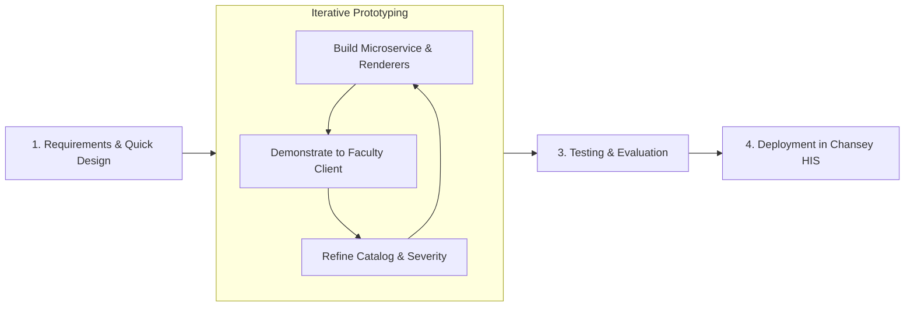
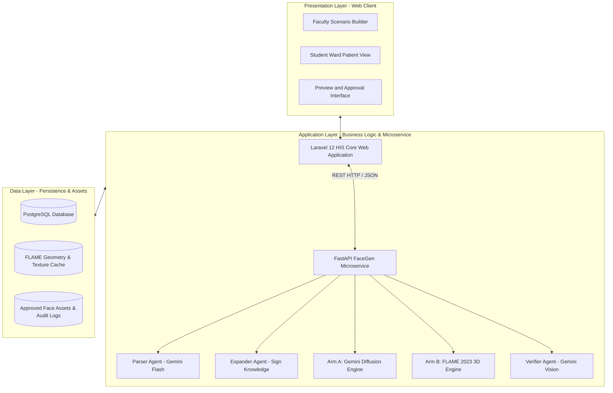
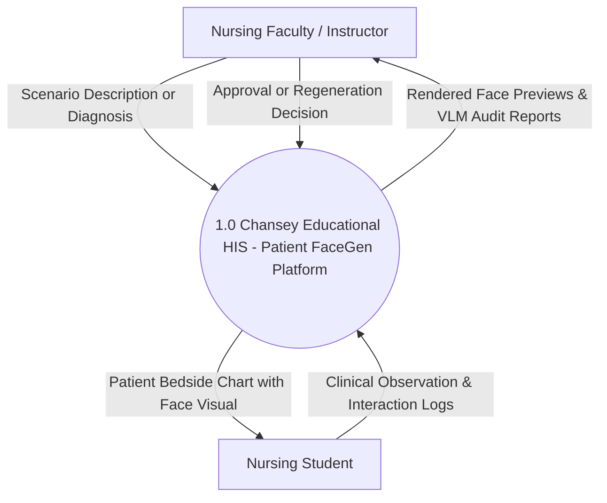
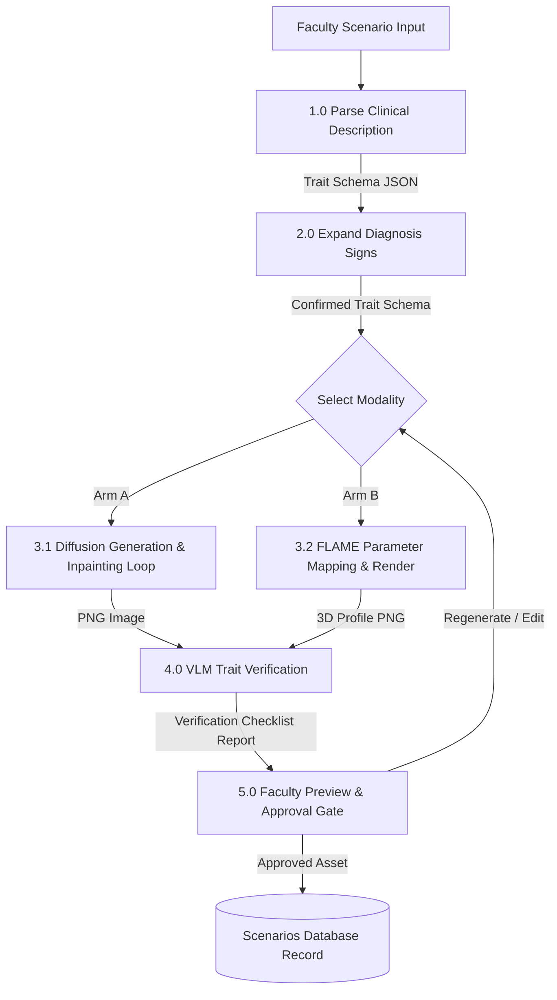
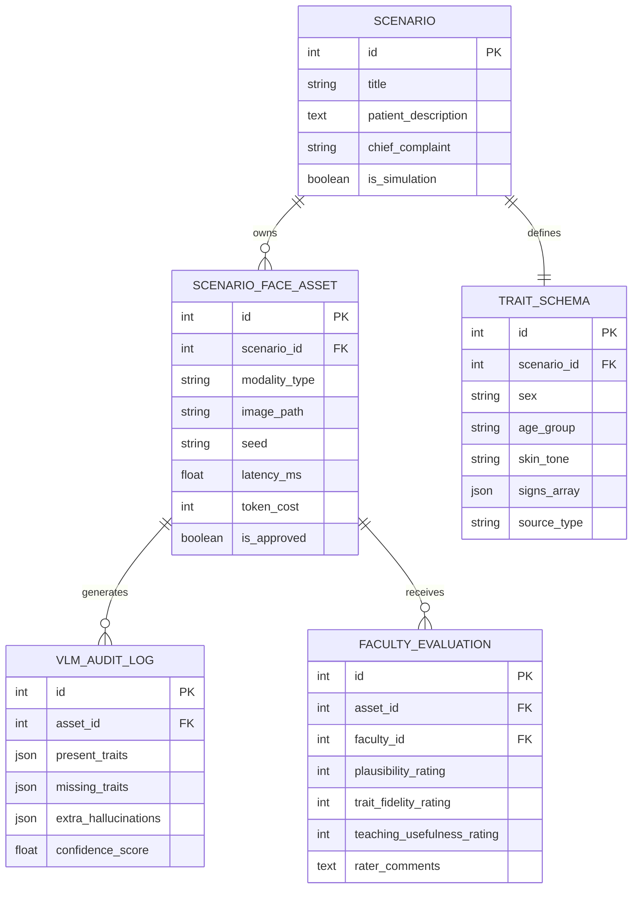
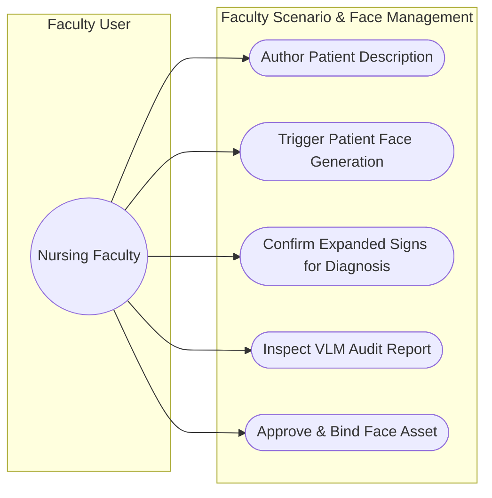
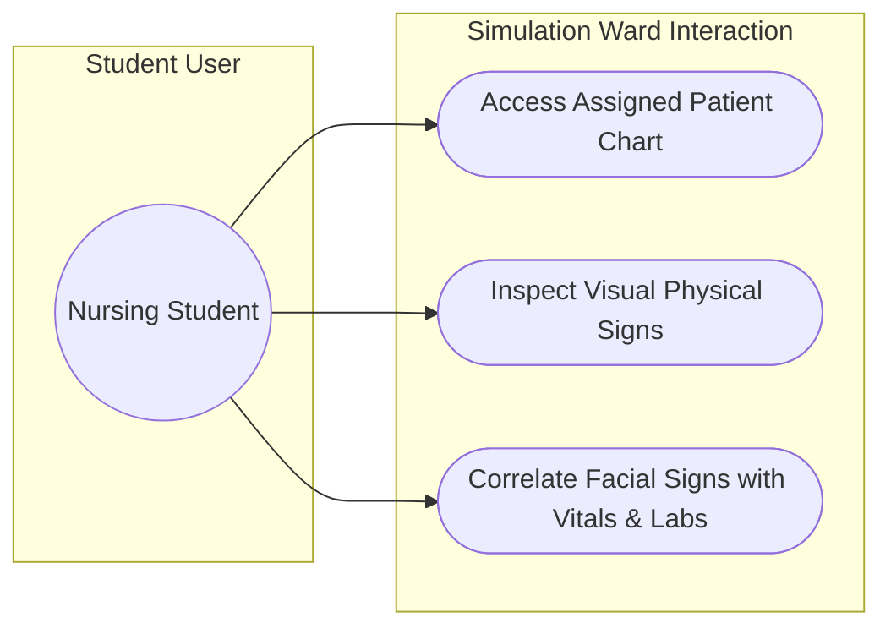
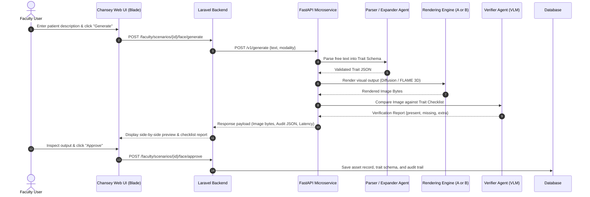
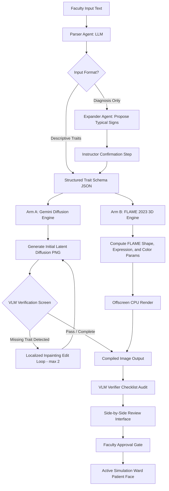

# Chapter 3

## Methodology

This study uses a comparative experimental research design combined with developmental software engineering to evaluate two patient-face rendering modalities: diffusion-generated images (Arm A) and a parametric three-dimensional head model (Arm B). Both modalities are implemented within the same educational hospital information system, Chansey, under a single constant agentic pipeline. This setup holds all upstream text parsing, sign expansion, and verification steps constant, ensuring that differences in trait fidelity, visual plausibility, skin-tone accuracy, and computing cost trace directly to the rendering modality itself.

The software development process follows the Rapid Application Development (RAD) model. RAD was chosen because it prioritizes working prototypes, short development cycles, and frequent feedback from the primary clinical stakeholder, Dr. Evan. In clinical simulation, visual realism is not an abstract aesthetic standard; it must align with what nursing instructors actually need to teach physical assessment. Short prototyping cycles allow the research team to build candidate outputs, demonstrate them to nursing faculty, and refine trait parameters, color tints, and severity mappings based on direct clinical input before running the formal evaluation.

The system development couples a web-based clinical information system built with Laravel with a dedicated Python microservice that handles language model parsing, API-based diffusion rendering, parametric mesh deformation, and vision-language model verification.

---

### Software Development Life Cycle (SDLC) Model

The project follows the four distinct phases of the Rapid Application Development (RAD) model: Requirements Planning and Quick Design, Prototype Cycles (Build, Demonstrate, and Refine), Testing, and Implementation.



**[Figure 3.1: Rapid Application Development (RAD) Model]**

#### 1. Requirements Planning and Quick Design
The development began by defining the functional and clinical requirements for patient visualization in Chansey. During this phase, the researchers identified that nursing faculty authoring scenarios need an automated way to generate patient faces without sourcing real patient photographs. The data structures for the trait schema and sign catalog were outlined, establishing the common ground needed between clinical text and rendering parameters.

#### 2. Prototype Cycles (Build, Demonstrate, Refine)
The prototype cycle operated as a repeated sequence of three steps:
- **Build**: The initial versions of the trait schema, the FastAPI microservice, the diffusion prompt compiler, and the FLAME 3D geometry pipeline were created. Integration hooks were added to Chansey's scenario builder interface.
- **Demonstrate**: Candidate rendered faces across representative conditions (such as jaundice, ptosis, and cyanosis) were presented to Dr. Evan and nursing faculty. Stakeholders evaluated whether the visual signs matched clinical expectations.
- **Refine**: Faculty feedback was used to adjust color hex palettes, severity thresholds, and blendshape weights. For instance, color tints for jaundice were adjusted to prevent unnatural yellow hues on darker skin presentations. This cycle repeated until the output reached acceptable clinical plausibility.

#### 3. Testing Phase
Once the prototype stabilized, the system entered formal testing. This phase encompassed two parts: automated technical verification of prompt adherence and latency, followed by the formal experimental evaluation where nursing faculty rated 24 to 30 stimulus scenarios across both modalities.

#### 4. Implementation Phase
The validated pipeline was deployed into the Chansey web platform. In this final phase, the scenario authoring interface allows instructors to generate, preview, and approve patient faces directly within their everyday workflow.

---

### System Development Tools

This section outlines the programming environments, frameworks, libraries, and database management systems used to build the platform.

#### Programming Languages and Frameworks
The system uses a decoupled client-server architecture:
- **PHP 8.2+ and Laravel 12**: Serves as the primary web application framework for Chansey HIS. It manages user authentication, role-based access control, clinical ward records, scenario authoring workflows, and database transactions.
- **Python 3.11+ and FastAPI**: Powers the machine learning and computer vision microservice. FastAPI was chosen for its high asynchronous throughput and native support for Pydantic data validation schemas.
- **FLAME 2023 Open**: Serves as the three-dimensional parametric head model (CC-BY-4.0). It runs on CPU using standard linear algebra routines in NumPy and PyTorch, avoiding the need for dedicated local graphics hardware.
- **Gemini API (Google AI Studio)**: Powers the multimodal AI pipeline. Gemini Flash handles structured text parsing and disease expansion, Gemini Image API generates the diffusion PNGs and processes localized inpainting edits, and Gemini Vision operates as the automated VLM verifier.
- **JavaScript, Tailwind CSS, and Blade**: Handled client-side responsiveness, asynchronous preview loading, and interactive image comparisons in the browser.

#### Integrated Development Environment (IDE)
Visual Studio Code served as the primary development environment. It provided workspace management, Git version control, Python virtual environment isolation, and debugging tools for both PHP and Python services.

#### Database Management System
The platform utilizes **PostgreSQL** (with **SQLite** supported for lightweight automated testing). PostgreSQL manages relational integrity across patient admissions, scenario templates, trait schemas, and evaluation logs, using foreign keys to guarantee audit traceability.

---

### Experimental Stimuli and Evaluation Dataset

To evaluate the two rendering modalities without data leakage or bias toward a single disease, the study uses a pre-registered evaluation dataset of 24 to 30 clinical scenario descriptions.

The stimuli were structured to test specific clinical sign categories:
1. **Color Signs (Systemic / Diffuse)**: Jaundice (scleral and cutaneous), pallor (conjunctival and facial), cyanosis (perioral), and facial flushing.
2. **Structural Symmetric Signs**: Periorbital edema, facial puffiness, diaphoresis (sweating), and glassy eyes.
3. **Structural Asymmetric Signs**: Unilateral ptosis, facial droop (cranial nerve VII palsy), and unilateral anisocoria.
4. **Secretions and Surface Manifestations**: Rhinorrhea (runny nose) and tearing.
5. **Demographic Variations**: Balanced distribution across male and female presentations and across all six Monk and Fitzpatrick skin-tone classifications.
6. **Input Types**: A mix of explicit trait descriptions and disease-only inputs (such as "acute viral hepatitis" or "Bell's palsy") to evaluate the expander agent.

```
+-------------------------------------------------------------------------+
|                  [Figure 3.2: Experimental Stimulus Grid]               |
|                                                                         |
|  [Arm A: Diffusion PNG]                 [Arm B: Parametric 3D Head]     |
|  - Symmetrical color signs (Jaundice)   - Deterministic tint overlay    |
|  - Asymmetrical signs (Ptosis/Droop)   - Unilateral blendshape mesh    |
|  - Graded Monk skin tones (I to VI)     - Explicit albedo parameter     |
+-------------------------------------------------------------------------+
```

**[Figure 3.2: Sample Outputs from the Evaluation Stimulus Set]**

Each scenario description in the dataset was converted into a ground-truth checklist by a clinical educator, specifying the required traits, their anatomical regions, laterality, and severity levels.

---

### Algorithms and Modalities Applied

The research compares two fundamentally different image generation paradigms under identical operational conditions.

```
+-------------------------------------------------------------------------+
|                 [Figure 3.3: Comparative Modality Overview]             |
|                                                                         |
|  Prompt -> Gemini Diffusion API -> Latent Denoising -> Photoreal PNG   |
|  Trait JSON -> FLAME Parameters -> CPU Linear Blendshapes -> 3D Mesh    |
+-------------------------------------------------------------------------+
```

**[Figure 3.3: Comparison of Image Synthesis Pipelines]**

#### Arm A: Diffusion-Based Image Generation (Gemini Image API)
Arm A operates through text-to-image latent diffusion. The structured trait schema is compiled into an explicit clinical prompt that includes demographic markers, laterality constraints, and anatomical descriptions. To mitigate the default light-skin bias documented by Joerg et al. (2025), explicit Monk/Fitzpatrick descriptors are injected into the prompt based on the method verified by O'Malley et al. (2024).

Because one-shot diffusion often omits fine-grained clinical details, Arm A incorporates an agentic correction loop. After initial generation, the image is passed to the VLM verifier. If a required trait is flagged as missing or an extra sign is detected, an automated localized inpainting instruction is submitted back to the model, allowing up to two correction cycles before final output.

#### Arm B: Parametric 3D Head Generation (FLAME 2023 Open)
Arm B uses an explicit mathematical model of human facial geometry. FLAME expresses facial shape and expression as linear combinations of basis vectors learned from registered 3D scans:

$$M(v, \beta, \theta, \psi) = \bar{T} + B_s(\beta) + B_p(\theta) + B_e(\psi)$$

Where:
- $\bar{T}$ is the base template mesh in resting pose.
- $B_s(\beta)$ represents shape displacements controlled by identity coefficients $\beta$.
- $B_p(\theta)$ represents pose blendshapes controlled by joint rotations $\theta$.
- $B_e(\psi)$ represents expression blendshapes controlled by expression parameters $\psi$.

In this study, color signs are not generated by diffusion texture maps. Instead, per-region albedo and tint parameters are applied directly to the anatomical UV regions of the mesh (such as sclera, lips, and cheek zones). Structural signs use target blendshapes: bilateral signs adjust standard expression vectors, while unilateral signs (such as left-sided ptosis) actuate localized unilateral blendshape weights. The deformed head is rendered offscreen into a standardized PNG profile.

#### Role of the Modalities in the System
Both renderers function as interchangeable backend modules. When the user initiates face generation, the microservice runs both arms concurrently or sequentially on the same parsed schema. The resulting previews are presented with their automated verification logs, allowing faculty to compare both outputs directly before selecting an approved asset.

---

### Methods of Evaluation

The evaluation combines automated objective metrics with clinical human ratings to answer all five research questions.

#### 1. Quantitative Trait Fidelity Metrics
Each generated face is evaluated against the ground-truth checklist established for its scenario description. Predictions are categorized into:
- **True Positive (TP)**: A required clinical trait is correctly depicted in the appropriate anatomical location and laterality.
- **False Positive (FP) / Hallucination**: A visual sign appears on the face that was neither requested nor clinically justified.
- **False Negative (FN)**: A requested clinical trait is completely missing or anatomically incorrect.
- **True Negative (TN)**: An unrequested sign is correctly absent from the face.

Based on these classifications, the following standard metrics are computed:

$$\text{Accuracy} = \frac{TP + TN}{TP + TN + FP + FN}$$

$$\text{Precision} = \frac{TP}{TP + FP}$$

$$\text{Recall} = \frac{TP}{TP + FN}$$

$$\text{F1 Score} = 2 \times \frac{\text{Precision} \times \text{Recall}}{\text{Precision} + \text{Recall}}$$

Trait recall rate and the count of hallucinated extra signs serve as the primary measures of trait fidelity (RQ1).

#### 2. Skin-Tone Concordance
Skin-tone fidelity is assessed by comparing the intended Monk skin-tone level (Monk 1 to 10) against the observed skin tone in the output image. Concordance is evaluated on an exact-match and within-one-level tolerance basis to determine whether either modality exhibits systematic demographic drift (RQ3).

#### 3. Operational Performance Metrics
The system logs technical metrics for every generation attempt:
- **Latency (ms)**: Total round-trip time from the initial request to the delivery of the rendered image.
- **Token and API Cost**: The count of input, output, and vision tokens consumed per generation attempt, along with the estimated monetary cost in US dollars (RQ4).
- **Hardware Footprint**: Memory usage and processor load during CPU-based 3D mesh rendering versus cloud API calls.

#### 4. Faculty Rating (Clinical Plausibility and Teaching Usefulness)
To evaluate clinical plausibility and educational utility (RQ2), generated faces are evaluated by a panel of Nursing Department faculty, including Dr. Evan. Evaluators review the outputs in a blinded randomized order, rating each image on a 5-point Likert scale across three core criteria:
1. **Clinical Plausibility**: Does the face present an anatomically believable appearance consistent with human pathology?
2. **Sign Fidelity**: Are the described symptoms clear, identifiable, and localized correctly?
3. **Teaching Usefulness**: Would this visual asset help nursing students recognize the condition during simulation?

Responses are interpreted using standard weighted mean intervals:

| Scale Value | Statistical Range | Qualitative Interpretation |
|---|---|---|
| 5 | 4.21 – 5.00 | Strongly Agree / Highly Plausible |
| 4 | 3.41 – 4.20 | Agree / Plausible |
| 3 | 2.61 – 3.40 | Neutral / Moderately Plausible |
| 2 | 1.81 – 2.60 | Disagree / Implausible |
| 1 | 1.00 – 1.80 | Strongly Disagree / Completely Implausible |

The weighted mean is calculated as:

$$\bar{x} = \frac{\sum (f \times x)}{N}$$

Where:
- $\bar{x}$ = weighted mean
- $f$ = frequency of responses for a scale category
- $x$ = Likert scale numerical value (1 to 5)
- $N$ = total number of faculty evaluations

#### 5. Statistical Significance Testing
To test whether observed differences between the two modalities are statistically significant (RQ3), the study uses inferential tests:
- **McNemar’s Test**: Used for paired binary data (presence or absence of each specific trait across matched scenario pairs).
- **Wilcoxon Signed-Rank Test**: Used for paired non-parametric comparisons of faculty ratings (plausibility, fidelity, usefulness) across matched scenarios.
- **Paired-Samples t-Test**: Used to compare continuous normal operational variables, specifically latency in milliseconds.
- **Cohen's Kappa ($\kappa$)**: Used to evaluate inter-rater agreement among faculty raters, as well as the agreement between the automated VLM verifier and human clinical scores, testing the validity of the automated judge as established by Hayes et al. (2025).

The null hypothesis ($H_0$) states that there is no significant difference between diffusion-generated PNGs and parametric 3D heads in trait fidelity, clinical plausibility, skin-tone fidelity, or processing time. The alternative hypothesis ($H_1$) asserts that a significant difference exists. All tests use a significance threshold of $\alpha = 0.05$, with $\alpha = 0.01$ used to designate high statistical significance.

---

### System Architecture

The patient-face generation module uses a three-tier architecture that integrates seamlessly with the existing Chansey HIS platform.



**[Figure 3.4: Three-Tier System Architecture of the Chansey FaceGen Platform]**

#### 1. Presentation Layer
The presentation layer provides the user interfaces for faculty and students. Built with Blade templates, Tailwind CSS, and lightweight JavaScript, it includes:
- The **Faculty Scenario Builder**, where instructors enter scenario text, click "Generate Patient Face", review generated options, inspect VLM checklist logs, and grant final approval.
- The **Student Ward View**, where the approved patient face appears on the virtual bedside chart alongside real-time vitals, physician orders, and nurse notes.

#### 2. Application Layer
The application layer coordinates clinical business logic and AI generation:
- **Laravel Backend**: Receives scenario inputs, enforces authorization policies, dispatches asynchronous HTTP calls to the microservice, and stores approved assets.
- **FastAPI Microservice (`services/facegen`)**: Executes the agentic pipeline. It handles text parsing, calls external cloud APIs for diffusion, manages local CPU-based mesh deformation for FLAME, and formats verification reports.

#### 3. Data Layer
The data layer manages structured records and generated media:
- **PostgreSQL Database**: Stores scenario definitions, clinical orders, user accounts, structured trait schema JSON blobs, and audit logs.
- **Asset Storage**: Stores generated PNG images and exported 3D model assets, flagged with AI-generated provenance metadata.

---

### Data Flow Diagram (DFD)

The flow of data through the system is documented across two levels of detail.

#### Level 0 Data Flow Diagram (Context DFD)
Figure 3.5 illustrates the context-level data interactions between the primary external entities (Faculty and Student) and the central Chansey platform.



**[Figure 3.5: Level 0 Context Data Flow Diagram]**

Faculty submit scenario descriptions and receive rendered previews paired with verification reports. Once approved, the platform binds the visual to the scenario admission. Nursing students access the simulation patient chart, observing the rendered physical signs while conducting simulated clinical care.

#### Level 1 Data Flow Diagram (Generation and Review Pipeline)
Figure 3.6 details the operational sequence inside the generation pipeline.



**[Figure 3.6: Level 1 Data Flow Diagram of the FaceGen Pipeline]**

---

### Entity-Relationship Diagram (ERD)

Figure 3.7 presents the relational database schema supporting scenario management, trait schemas, generated face assets, and evaluation logs.



**[Figure 3.7: Entity-Relationship Diagram (ERD)]**

#### Database Table Descriptions:
- **`scenarios`**: Core table storing scenario titles, clinical background, and simulation admission details.
- **`trait_schemas`**: Stores normalized clinical parameters extracted from the text (demographics, skin tone, and sign arrays with severity and laterality).
- **`scenario_face_assets`**: Stores generated output metadata, including the modality type (`png` or `3d`), file path, random seed, latency, token consumption, and approval status.
- **`vlm_audit_logs`**: Logs automated verification results, recording which traits were identified as present, missing, or hallucinated.
- **`faculty_evaluations`**: Stores blinded faculty Likert scores and qualitative remarks collected during the experimental evaluation.

---

### Use Case Diagrams

The behavioral interactions with the system are divided into instructor and student use cases.

#### Faculty Use Case Diagram
Figure 3.8 shows the capabilities available to nursing instructors managing scenarios and visual assets.



**[Figure 3.8: Faculty Use Case Diagram]**

The primary use cases include authoring scenario descriptions, triggering generation across either modality, confirming signs proposed by the expander agent, reviewing the automated VLM audit report, and approving the final face asset.

#### Student Use Case Diagram
Figure 3.9 depicts how nursing students interact with the generated faces during clinical simulation.



**[Figure 3.9: Student Use Case Diagram]**

Students do not interact with the generation pipeline directly. Instead, they view the approved patient face within the bedside chart, correlating visual symptoms (such as lip pallor or scleral icterus) with vital signs and physician orders.

---

### Sequence Diagram

Figure 3.10 outlines the chronological sequence of operations during face generation and approval.



**[Figure 3.10: Sequence Diagram for Patient Face Generation and Approval]**

---

### Machine Learning and Agent Pipeline Diagram

Figure 3.11 illustrates the end-to-end execution pipeline. This pipeline remains constant across both experimental arms, ensuring that prompt handling, schema normalization, and verification standards do not vary between modalities.



**[Figure 3.11: Constant Agentic Generation and Verification Pipeline]**

The pipeline enforces an instructor-in-the-loop architecture. When given disease-only inputs (such as "severe dehydration"), the expander agent proposes visible signs (sunken eyes, dry lips), but these must be confirmed by the instructor before rendering occurs. The system never silently invents clinical traits.

---

### Software Requirements Specification (SRS)

This section defines the minimum and recommended hardware, software, and functional parameters required to execute the platform.

#### Table 3.1: System Requirements

| Category | Minimum Requirements | Recommended Requirements |
|---|---|---|
| **Operating System** | Windows 10 (64-bit), Ubuntu 20.04 LTS | Windows 11 (64-bit), Ubuntu 22.04 LTS |
| **Web Browser** | Google Chrome, Microsoft Edge, Brave (latest 2 versions) | Google Chrome, Brave (latest updated version) |
| **Backend Environment** | PHP 8.2+, Python 3.10+, Composer 2.5+ | PHP 8.3+, Python 3.11+, Composer 2.7+ |
| **Libraries & Packages** | Laravel 12, FastAPI, Pydantic, NumPy, PyTorch (CPU) | Laravel 12, FastAPI, PyTorch (CPU), PyRender, Trimesh |
| **Database** | SQLite 3.35+ | PostgreSQL 14+ |
| **Client Hardware** | Intel Core i3 / AMD Ryzen 3, 8 GB RAM | Intel Core i5 / AMD Ryzen 5, 16 GB RAM |
| **Network & Hosting** | Broadband Internet (20 Mbps) for API calls | Stable Broadband (50 Mbps+) |

#### Functional Requirements
1. **Clinical Text Parsing**: The system shall parse free-text scenario descriptions into a structured trait schema containing sex, age group, skin tone, and an array of clinical signs with anatomical region, laterality, and severity.
2. **Diagnosis Expansion with Human Confirmation**: When an instructor inputs a diagnosis without physical traits, the system shall propose typical visible signs and require instructor confirmation before rendering.
3. **Dual Modality Rendering**: The system shall support rendering patient faces via both diffusion-based PNG synthesis (Arm A) and parametric 3D mesh projection (Arm B).
4. **Agentic Editing Loop**: For the diffusion arm, the system shall automatically trigger localized inpainting edits (up to two cycles) if the automated verifier detects missing requested traits.
5. **Deterministic Parametric Mapping**: For the 3D arm, the system shall map color signs to standardized anatomical UV albedo regions and map structural signs to calibrated FLAME blendshape weights without relying on random seeds.
6. **Automated VLM Verification**: The system shall evaluate rendered images against a structured trait checklist using a vision-language model and output a structured report of present, missing, and hallucinated features.
7. **Instructor Approval Gate**: The system shall keep all generated faces in an unapproved preview state until explicitly accepted by faculty.
8. **Clinical Simulation Integration**: Upon approval, the system shall bind the image asset to the patient admission record in Chansey, making it visible on the virtual bedside chart during student simulations.

#### Non-Functional Requirements
1. **Performance and Latency**: API-based diffusion generation and CPU-based 3D rendering shall complete within 15 seconds per generation cycle to remain practical for real-time classroom scenario authoring.
2. **Reliability and Determinism**: The 3D parametric arm shall yield identical mesh geometry and color parameters when executed repeatedly on the same trait schema.
3. **Data Privacy and Protection**: The system shall use synthetic generative modeling exclusively and shall not ingest, store, or process real patient photographs, complying with Republic Act No. 10173 (Philippine Data Privacy Act of 2012).
4. **Usability**: The interface shall provide side-by-side visual comparisons, trait confirmation checkboxes, and clear status badges indicating whether an asset is approved or pending review.
5. **Availability**: The local microservice and web application shall remain operational without requiring local GPU acceleration, relying on standard cloud API endpoints for neural rendering.
6. **Scalability**: The database and file storage architecture shall support expanding sign catalogs and growing libraries of approved simulation scenarios across multiple academic terms.
7. **Compatibility**: Generated image assets shall render seamlessly across modern web browsers without requiring client-side graphics extensions or specialized hardware.
8. **Maintainability**: The codebase shall maintain modular separation between the Laravel clinical information system and the FastAPI generative microservice, ensuring that AI provider updates do not affect core hospital information workflows.

